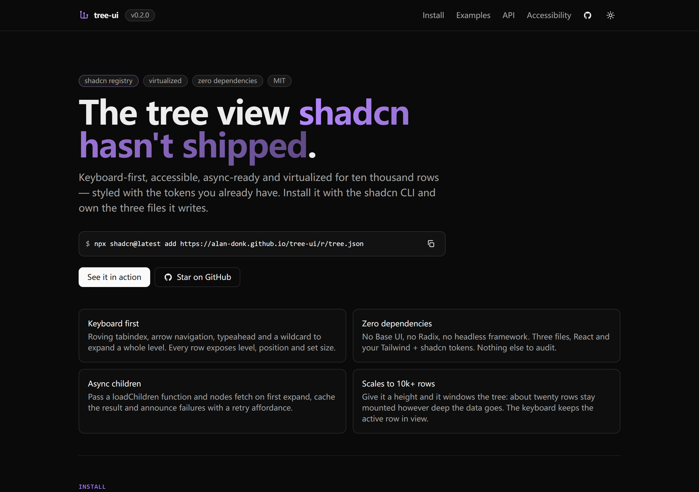
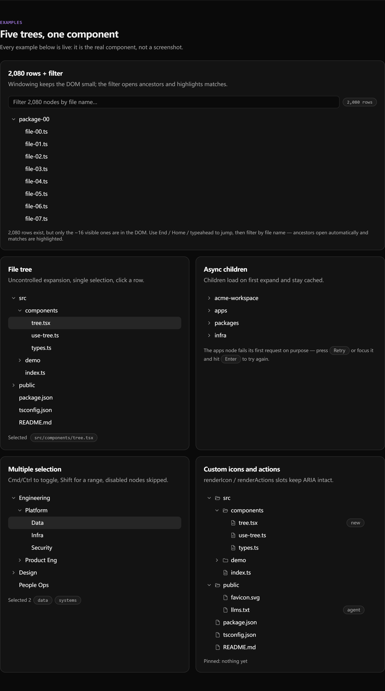
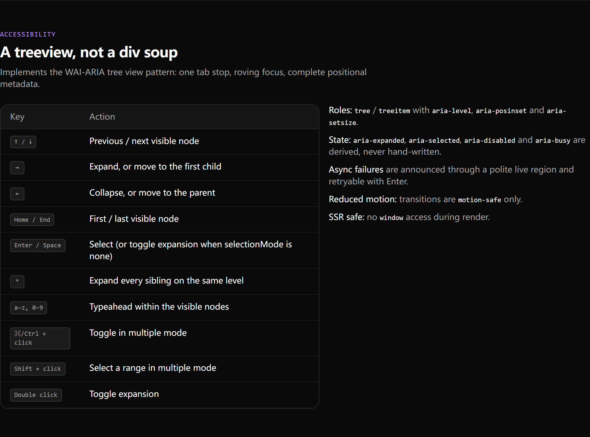

# tree-ui

> An accessible tree view for shadcn/ui: virtualized for 10k+ rows, filterable,
> async-ready, and zero dependencies. Install with the shadcn CLI and own the code.

[](https://alan-donk.github.io/tree-ui)

**Live demo:** https://alan-donk.github.io/tree-ui · **Registry:** https://alan-donk.github.io/tree-ui/r/tree.json

## Install

```bash
npx shadcn@latest add https://alan-donk.github.io/tree-ui/r/tree.json
```

This writes:

- `components/tree/tree.tsx` — the component
- `components/tree/use-tree.ts` — state, keyboard, filter and async logic
- `components/tree/types.ts` — public types

Requirements: React 19 and the default shadcn/ui CSS variables (`bg-accent`,
`ring-ring`, `text-muted-foreground`, …). There are no runtime dependencies.

Prefer a package? The same source is published as `@alan-donk/tree-ui`
(`npm i @alan-donk/tree-ui`), but the registry is the recommended path — you get
code you can edit.

Manual install: copy `src/registry/tree/*` from the repository into
`components/tree/`.

## Usage

```tsx
import { Tree } from "@/components/tree/tree"

const data = [
  { id: "src", label: "src", children: [{ id: "src/index.ts", label: "index.ts" }] },
]

export function Files() {
  return (
    <Tree
      data={data}
      aria-label="Project files"
      defaultExpandedIds={["src"]}
      onSelectionChange={(ids) => console.log(ids)}
    />
  )
}
```

### Async children

```tsx
<Tree
  data={[{ id: "workspace", label: "workspace" }]}
  aria-label="Workspace"
  loadChildren={async (node) => fetchChildren(node.id)}
  onLoadError={(node, error) => report(node, error)}
/>
```

Children load on first expand, are cached per node id, and failures render a
retry affordance that is also reachable with Enter.

### Multiple selection

```tsx
<Tree data={teams} aria-label="Teams" selectionMode="multiple" selectedIds={ids} onSelectionChange={setIds} />
```

Cmd/Ctrl-click toggles, Shift-click selects the visible range, disabled nodes are
skipped.

### Large trees: windowing + filter

```tsx
<Tree
  data={files}
  aria-label="Files"
  height={320}        // fixed viewport → only visible rows are mounted
  filter={query}      // case-insensitive; ancestors auto-open, matches highlighted
  defaultExpandedIds={folderIds}
/>
```

2,000+ rows mount as ~20. Arrow keys, Home/End and typeahead scroll the active row
into view, and `aria-posinset` / `aria-setsize` keep reporting the full tree, not
the window. Filtering is view-only: your expansion and selection state is untouched
and comes back when the filter clears.



## API

| Prop | Type | Default | Description |
| --- | --- | --- | --- |
| `data` | `TreeNode[]` | — | Root nodes; `id` must be unique |
| `aria-label` | `string` | — | Accessible name (required) |
| `selectionMode` | `"none" \| "single" \| "multiple"` | `"single"` | Selection behaviour |
| `filter` | `string` | — | Case-insensitive filter; view-only, ancestors auto-expand |
| `height` | `number` | — | Fixed height in px; enables windowing |
| `overscan` | `number` | `6` | Extra rows rendered outside the viewport |
| `expandedIds` | `string[]` | — | Controlled expansion |
| `defaultExpandedIds` | `string[]` | `[]` | Initial expansion |
| `onExpandedChange` | `(ids: string[]) => void` | — | Expansion callback |
| `selectedIds` | `string[]` | — | Controlled selection |
| `defaultSelectedIds` | `string[]` | `[]` | Initial selection |
| `onSelectionChange` | `(ids: string[]) => void` | — | Selection callback |
| `loadChildren` | `(node) => Promise<TreeNode[]>` | — | Async children |
| `onLoadError` | `(node, error) => void` | — | Async failure hook |
| `renderIcon` | `(node, ctx) => ReactNode` | — | Icon slot |
| `renderActions` | `(node, ctx) => ReactNode` | — | Trailing slot |
| `renderEmpty` | `() => ReactNode` | — | Empty state |
| `indent` | `number` | `16` | Pixels per level |
| `messages` | `Partial<TreeMessages>` | — | Copy for loading/retry/chevrons |
| `className` / `itemClassName` | `string` | — | Class hooks |

`TreeNode = { id, label, children?, icon?, disabled?, searchText?, data? }`.

## Keyboard

| Key | Action |
| --- | --- |
| ↑ / ↓ | Previous / next visible node |
| → | Expand, or move to the first child |
| ← | Collapse, or move to the parent |
| Home / End | First / last visible node |
| Enter / Space | Select (toggles expansion when `selectionMode="none"`) |
| `*` | Expand every sibling on the same level |
| a–z, 0–9 | Typeahead |
| Double click | Toggle expansion |

## Accessibility

Implements the WAI-ARIA tree view pattern: a single tab stop with roving focus,
`role="tree"` / `role="treeitem"`, plus `aria-level`, `aria-posinset`,
`aria-setsize`, `aria-expanded`, `aria-selected`, `aria-disabled` and
`aria-busy`. Windowed rendering keeps those attributes accurate for the whole
tree, not just the rendered rows. Async failures are announced through a polite
live region. Transitions are `motion-safe` only. Tests include an axe scan of the
rendered tree.



## Development

> Do not open `index.html` directly in a browser — it is the Vite entry point and
> only prints a "needs the Vite dev server" notice. Use the commands below.

```bash
npm install
npm run dev         # demo site
npm run screenshot  # refresh docs/*.png from the built demo
npm run build:lib   # emit dist-lib/ (npm package entry)
npm run verify      # lint + typecheck + tests + build + registry + package checks
```

`npm run screenshot` drives Playwright against `vite preview`. Playwright's
Chromium download is blocked on some networks, so the script falls back to an
installed Chrome or Edge (`PW_CHANNEL=chrome|msedge|chromium` to force one).

Publishing to GitHub: see [PUBLISH.md](./PUBLISH.md) and
[GITHUB-SETUP.md](./GITHUB-SETUP.md).

## Scope

v0.2.0 ships a data-driven tree with async children, multi-select, filtering and
windowed rendering. Drag-and-drop, tri-state checkboxes, column alignment and a Vue
port are on the roadmap — see [CHANGELOG.md](./CHANGELOG.md).

## License

MIT
