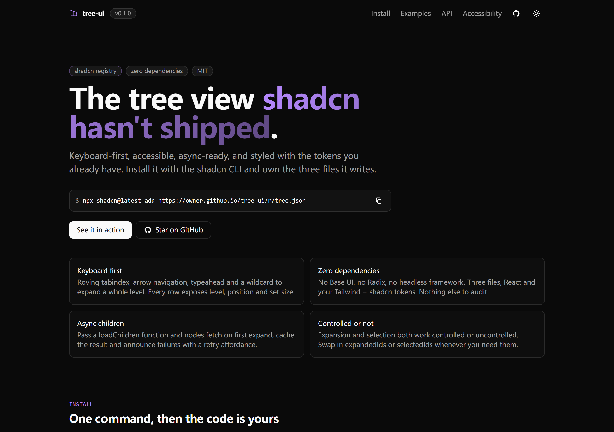
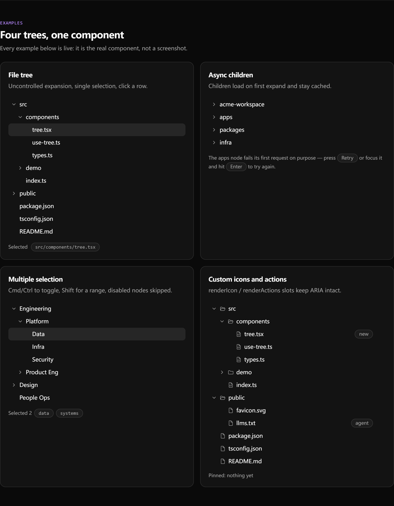
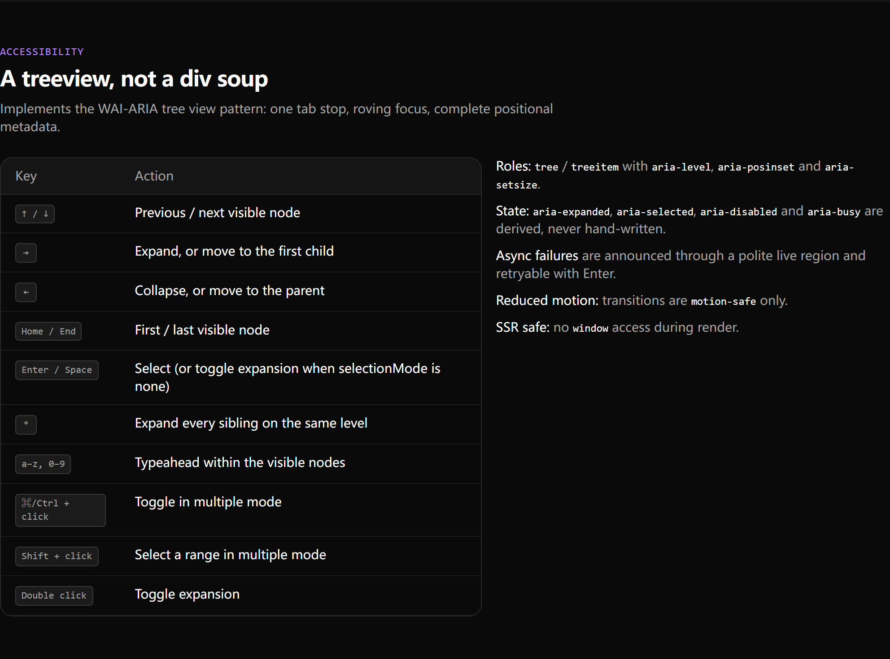

# tree-ui

> 一个可访问、零依赖的 shadcn/ui 树形组件。用 shadcn CLI 安装，代码归你所有。

[]({{SITE_URL}})

**在线 Demo：** {{SITE_URL}} · **Registry：** {{REGISTRY_URL}}

## 安装

```bash
npx shadcn@latest add {{REGISTRY_URL}}
```

会写入三个文件：

- `components/tree/tree.tsx` — 组件本体
- `components/tree/use-tree.ts` — 状态、键盘与异步逻辑
- `components/tree/types.ts` — 公共类型

前置条件：React 19 + shadcn/ui 默认 CSS 变量（`bg-accent`、`ring-ring`、
`text-muted-foreground` 等）。**没有运行时依赖**，不引 Base UI / Radix。

手动安装：把仓库里的 `src/registry/tree/*` 复制到 `components/tree/`。

## 用法

```tsx
import { Tree } from "@/components/tree/tree"

const data = [
  { id: "src", label: "src", children: [{ id: "src/index.ts", label: "index.ts" }] },
]

export function Files() {
  return (
    <Tree
      data={data}
      aria-label="项目文件"
      defaultExpandedIds={["src"]}
      onSelectionChange={(ids) => console.log(ids)}
    />
  )
}
```

### 异步子节点

```tsx
<Tree
  data={[{ id: "workspace", label: "workspace" }]}
  aria-label="工作区"
  loadChildren={async (node) => fetchChildren(node.id)}
  onLoadError={(node, error) => report(node, error)}
/>
```

首次展开时拉取并按节点 id 缓存；失败会渲染重试按钮，聚焦后按 Enter 也能重试。

### 多选

```tsx
<Tree data={teams} aria-label="团队" selectionMode="multiple" selectedIds={ids} onSelectionChange={setIds} />
```

⌘/Ctrl 点击切换，Shift 点击选中可见区间，disabled 节点自动跳过。



## 键盘

| 按键 | 行为 |
| --- | --- |
| ↑ / ↓ | 上一个 / 下一个可见节点 |
| → | 展开，或进入第一个子节点 |
| ← | 折叠，或回到父节点 |
| Home / End | 第一个 / 最后一个可见节点 |
| Enter / Space | 选中（`selectionMode="none"` 时为展开/折叠） |
| `*` | 展开同级全部节点 |
| 字母 / 数字 | typeahead 跳转 |
| 双击 | 展开 / 折叠 |

## 可访问性

遵循 WAI-ARIA treeview 模式：单一 Tab 焦点 + roving focus，输出
`role="tree"` / `role="treeitem"` 以及 `aria-level`、`aria-posinset`、
`aria-setsize`、`aria-expanded`、`aria-selected`、`aria-disabled`、
`aria-busy`。异步失败通过 polite live region 播报，动画只在
`motion-safe` 下启用，测试包含 axe 扫描。



## 本地开发

```bash
npm install
npm run dev        # 演示站
npm run screenshot # 从构建产物重新生成 docs/*.png
npm run verify     # lint + typecheck + 测试 + 构建 + registry 校验
```

`npm run screenshot` 用 Playwright 驱动 `vite preview`。部分网络下 Playwright
自带的 Chromium 下载会被阻断，脚本会自动退回本机已装的 Chrome / Edge，也可以用
`PW_CHANNEL=chrome|msedge|chromium` 强制指定。

发布到 GitHub 见 [PUBLISH.md](./PUBLISH.md) 与 [GITHUB-SETUP.md](./GITHUB-SETUP.md)。

## 范围

v0.1.0 提供数据驱动的树、异步子节点与多选。虚拟滚动、拖拽、搜索高亮、Vue
版本在路线图里，见 [CHANGELOG.md](./CHANGELOG.md)。

## 许可

MIT
